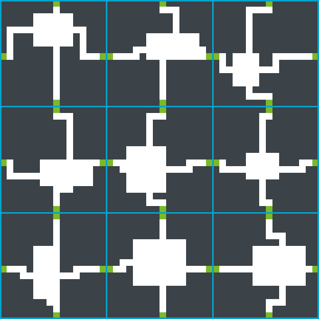

**LICENCIATURA EN DESARROLLO DE VIDEOJUEGOS Y SIMULACIÓN**

Simulación I · Primer parcial · 2026

**Documento de diseño técnico**

Raycasting sobre grilla con DDA y generación procedural

de mazmorras por chunks

**Integrantes** Juan Manuel Gelay · Alejo Hutmacher

**Profesor** Facundo Toufick Saiegh

Hurlingham, provincia de Buenos Aires, 29 de septiembre de 2026  
Actualizado el 13 de octubre de 2026 (feedback profesor)

# 1. Introducción
## 1.1 Contexto y consigna
Este documento es el diseño técnico del proyecto de la materia **Simulación I**, de la Licenciatura en Desarrollo de Videojuegos y Simulación de la Universidad Nacional de Hurlingham, 2026. El grupo de trabajo está formado por Juan Manuel Gelay y Alejo Hutmacher.

La consigna pide describir dos algoritmos de simulación y justificar su uso dentro de un proyecto propio. Elegimos dos que se necesitan mutuamente: **raycasting sobre grilla con DDA**, que convierte un mapa en grilla en una vista en primera persona, y **generación procedural de mazmorras por chunks**, que produce ese mapa a medida que el jugador lo recorre. Los dos se implementan en JavaScript clásico con PixiJS v8, en un proyecto que se abre con doble clic en index.html, sin instalar nada y sin levantar un servidor.

## 1.2 Resumen del proyecto
El proyecto es un juego de exploración y supervivencia en primera persona. Toda la lógica espacial vive en un mapa bidimensional en grilla, visto desde arriba, pero la vista del jugador se renderiza en primera persona mediante raycasting, emulando el estilo clásico de Wolfenstein 3D.

El escenario es una **mazmorra generada proceduralmente en tiempo de ejecución**. El mundo no tiene bordes: se arma por bloques a medida que el jugador avanza, así que el jugador puede caminar en cualquier dirección, incluso hacia coordenadas negativas, sin encontrar nunca un límite del mapa.

## 1.3 Alcance mínimo y alcance deseable
Separamos dos niveles de ambición para que la entrega no dependa de terminar todo.

El **alcance mínimo** es lo que nos comprometemos a entregar: recorrer en primera persona una mazmorra infinita generada proceduralmente, con colisiones contra las paredes y un minimapa, dibujado con colores planos. El capítulo 7 lo desglosa en fases y criterios de éxito.

El **alcance deseable** son las extensiones que se implementan solo si el alcance mínimo cierra con tiempo de sobra: combate, enemigos con máquina de estados, HUD completo, texturas e iluminación por distancia. El capítulo 2.3 las describe. Ninguna de ellas condiciona la entrega.

# 2. Descripción del juego
## 2.1 Bucle de juego
El jugador aparece en el centro de una sala y explora la mazmorra en primera persona. En el alcance mínimo no hay condición de victoria ni de derrota: el bucle es caminar, girar y orientarse con el minimapa. Las condiciones de victoria y derrota llegan con el sistema de combate del alcance deseable.

## 2.2 Controles del jugador
El esquema de movimiento usa las teclas WASD:

- **W / S**: desplazamiento del personaje hacia adelante y hacia atrás, en la dirección en la que mira.

- **A / D**: rotación de la cámara sobre su propio eje, a izquierda y a derecha.

El esquema deja afuera a propósito el desplazamiento lateral y el giro con el mouse. La razón es técnica: con solo avance y rotación, el estado de la cámara se reduce a un vector dirección y un vector plano, y girar es aplicar la misma matriz de rotación a los dos. Agregar desplazamiento lateral o giro con el mouse no cambia el algoritmo, solo la entrada, así que puede sumarse después sin tocar el raycaster.

## 2.3 Alcance deseable: posibles extensiones
### 2.3.1 Combate y supervivencia
- **Sistema de vida**: el jugador tiene una barra de salud. Recibir daño de un enemigo al colisionar disminuye ese valor, y si llega a cero el jugador muere y pierde la partida.

- **Armamento y disparo**: el jugador dispone de un arma de fuego que se dispara con la barra espaciadora, apuntando con una mira fija en el centro de la pantalla. El impacto se resuelve con raycasting. El rayo del disparo sale del jugador y recorre la grilla celda por celda con el mismo DDA del capítulo 3. Como la mira está fija en el centro, ese rayo es el de la columna central: cameraX vale 0 y rayDir es igual a dir. Cada enemigo queda registrado en la celda que ocupa, así el recorrido distingue las celdas con enemigos de las vacías. Al llegar a una celda con enemigos, se calcula si el rayo pega contra el collider de alguno, circular o rectangular. Si no pega, el rayo sigue, y si antes llega a una pared, el disparo no impacta.

- **Gestión de munición**: la reserva total es infinita, para favorecer un ritmo constante, pero el cargador tiene capacidad limitada, así que el jugador debe recargar cada cierta cantidad de disparos.

### 2.3.2 Enemigos y comportamiento
La mazmorra estaría habitada por un único tipo de enemigo, controlado por una **máquina de estados**. En esta primera iteración el enemigo se representa como un cuadrado geométrico sin textura, lo que deja preparado el terreno para aplicarle sprites más adelante. Los estados previstos son:

- **Reposo**: el enemigo permanece estático en su zona.

- **Patrulla**: movimiento automático dentro de un área definida.

- **Persecución**: al detectar al jugador mediante una comprobación de línea de visión, que es un raycast contra el mismo mapa, el enemigo abandona la patrulla, persigue al jugador y le inflige daño por contacto.

Vale la pena notar que la línea de visión del enemigo y el disparo del jugador reutilizan el mismo recorrido DDA del capítulo 3. El render, la percepción de la IA y la detección de impactos son el mismo código con distinto propósito.

La iluminación también puede resolverse con raycasting.

### 2.3.3 Elementos en pantalla
La vista en primera persona se acompañaría de un HUD minimalista con cuatro elementos superpuestos:

- **Mira**: elemento central estático para apuntar durante el combate.

- **Barra de vida**: indicador del estado de salud actual.

- **Contador de munición**: disparos restantes antes de tener que recargar.

- **Minimapa**: representación reducida del mapa 2D sobre el que se renderiza el entorno. Sirve a la vez como herramienta de orientación para el jugador y como validación visual del motor lógico. Este último es el único de los cuatro que forma parte del alcance mínimo.

# 3. Algoritmo 1: raycasting sobre grilla con DDA
## 3.1 Qué resuelve
El raycasting convierte un mapa 2D en grilla en una vista en primera persona lanzando un rayo por cada columna de la pantalla. Todo el cálculo es de dos dimensiones, y por eso se lo llama pseudo 3D: la sensación de profundidad sale de la distancia medida hasta cada pared, no de una escena tridimensional. En este documento el término nombra siempre esa técnica de render, distinta del raytracing de los gráficos realistas.

Lo elegimos por dos motivos. Primero, porque el costo no depende del tamaño del mundo, lo que hace compatible el render con una mazmorra infinita. Segundo, porque el algoritmo trabaja directamente sobre la grilla de celdas que produce el generador, sin ninguna capa de conversión entre los dos sistemas.

## 3.2 Modelo de cámara
El jugador tiene una posición pos, un vector dirección dir y un vector plane perpendicular a dir que representa el plano de la pantalla visto desde arriba. El largo de plane respecto del de dir define el campo de visión: con dir de largo 1 y plane de largo 0,66, el campo de visión ronda los 66 grados.

Por cada columna x de la pantalla se calcula:

**cameraX = 2 \* x / ancho - 1**

Ese valor va de -1 en el borde izquierdo de la pantalla a +1 en el derecho, y con él la dirección del rayo queda:

**rayDir = dir + plane \* cameraX**

rayDir apunta a un punto del plano de cámara y se usa con el largo que le da esa suma, sin normalizar. Para girar, dir y plane se rotan el mismo ángulo con una matriz de rotación, así se mantienen perpendiculares y el campo de visión no cambia.

## 3.3 Recorrido del rayo con DDA
El DDA (Digital Differential Analyzer) salta de una línea de la grilla a la siguiente. Cada iteración cruza exactamente un borde de celda, así que el rayo visita todas las celdas que atraviesa, sin saltearse ninguna y sin muestrear de más.

mapX y mapY arrancan en la celda del jugador. Por rayo se precalculan:

- deltaDistX = 1 / \|rayDirX\| y deltaDistY = 1 / \|rayDirY\|: lo que recorre el rayo entre una línea vertical de la grilla y la siguiente, y entre una horizontal y la siguiente. Son constantes por rayo: se calculan una vez, antes del bucle, y no cambian durante el recorrido.

- **Por qué el numerador es 1.** La fórmula geométrica es \|rayDir\| / \|rayDirX\|, que da distancia euclídea. Poner 1 en su lugar equivale a medir todo en unidades de \|rayDir\| en vez de en unidades de mundo. El DDA no se entera, porque los dos ejes quedan escalados por el mismo factor y la comparación entre ellos no cambia. Pero la simplificación hace algo mejor que no romper nada: como dir mide 1 y plane es perpendicular a dir, esa unidad escalada **es** la distancia perpendicular al plano de cámara. El bucle entrega gratis el número que necesita la proyección de la sección 3.4, sin ninguna conversión posterior.

- **Por qué la división por cero no rompe nada.** Un rayo perfectamente vertical no cruza ninguna línea vertical de la grilla, ni a diez celdas ni a mil. Su deltaDistX es infinito de verdad, no por un error de cálculo. En JavaScript 1 / 0 da Infinity sin lanzar excepción, e Infinity nunca resulta menor que un valor finito, así que ese eje nunca gana la comparación y el rayo avanza siempre por el otro. El caso degenerado se resuelve solo, sin un if especial.

- sideDistX y sideDistY, las distancias desde la posición del jugador hasta la próxima línea vertical y hasta la próxima línea horizontal.

- stepX y stepY, que valen +1 o -1 según el signo de cada componente de la dirección.

El bucle compara los dos acumuladores, avanza en el eje del menor, mueve el índice de celda en ese eje, registra en side qué cara cruzó y corta cuando cae en una celda de pared o cuando supera la distancia máxima.

## 3.4 Proyección en pantalla
La altura de la franja que se dibuja en esa columna se calcula con la **distancia perpendicular al plano de cámara**, no con la distancia euclídea hasta el punto de impacto. Medida así, una pared recta se dibuja recta de un borde a otro de la pantalla. Con la distancia euclídea aparece el efecto ojo de pez, con las paredes curvadas hacia los bordes.

**alturaFranja = alturaPantalla / distPerp**

La franja se centra en el horizonte, a la mitad de la pantalla, y se recorta contra los bordes cuando la pared está muy cerca. La distancia perpendicular no hace falta calcularla aparte: se lee del estado final del DDA como sideDistX - deltaDistX o sideDistY - deltaDistY, según cuál fue el último eje en avanzar.

## 3.5 Por qué cuenta como algoritmo de simulación
El motor simula cómo le llega la luz al ojo del jugador, con una muestra por columna de pantalla. Cada rayo resuelve dos preguntas sobre el mundo: qué pared es visible en esa dirección y a qué distancia está. El resultado no es una aproximación estética, es la respuesta geométrica exacta para esa dirección dentro del modelo discreto de la grilla.

## 3.6 Costo computacional
El trabajo por cuadro es proporcional a la cantidad de columnas multiplicada por la cantidad de celdas que cada rayo atraviesa hasta chocar o hasta llegar al tope de distancia. **El tamaño del mundo queda fuera de la cuenta**, y eso es exactamente lo que permite que el mundo sea infinito sin que el render se vuelva más caro.

El desarrollo extenso del tema, con los diagramas geométricos y el trazado de un DDA paso a paso, está en el material de apoyo del equipo, citado en el capítulo 8.

# 4. Algoritmo 2: generación procedural de mazmorras por chunks
## 4.1 Qué resuelve
El generador responde una sola pregunta, para cualquier par de coordenadas enteras: qué hay en esa celda. El valor 0 es aire y el 1 es pared.

El mundo se divide en **chunks de 16 por 16 celdas**. Cada chunk es un bloque de mazmorra con una sala y los corredores que la conectan con los cuatro chunks vecinos. Un chunk se genera la primera vez que se consulta alguna de sus celdas, y a partir de ahí queda guardado en memoria.

## 4.2 Generación de un chunk, paso a paso
1.  Se crea un arreglo de 16 por 16 celdas, todas pared.

2.  Se sortea una sala rectangular de entre 4 y 8 celdas de lado, ubicada con un margen de al menos dos celdas de pared contra cada borde del chunk, y se la talla en aire.

3.  Se fijan las cuatro puertas del chunk, siempre en la misma posición: la celda del medio de cada borde, es decir la fila 8 o la columna 8.

4.  Cada puerta se une a la sala con un corredor de tres tramos rectos: sale de la puerta hacia adentro del chunk, dobla en una fila o columna sorteada entre el borde y la sala hasta alinearse con el centro de la sala, y entra derecho.

5.  El chunk terminado se guarda en el Map de chunks con una clave numérica única, calculada a partir de cx y cy (sección 6.8).



*Figura 1. Nueve chunks generados con este algoritmo. Las líneas celestes marcan las fronteras entre chunks y las celdas verdes son las puertas. Cada puerta queda pegada a la puerta del chunk vecino.*

## 4.3 Por qué el mundo siempre es transitable
Las puertas están en la misma posición en todos los chunks, así que la puerta este de un chunk queda pegada a la puerta oeste del chunk de al lado, y lo mismo en vertical. Dentro de cada chunk, la sala llega a sus cuatro puertas, y cada puerta lleva a la sala vecina. Encadenando chunks se llega desde cualquier sala a cualquier otra.

Lo importante del argumento es que **la conectividad sale de la construcción**: el generador arma cada chunk sin mirar a sus vecinos y sin recorrer el mapa después para verificar que no quedó una zona aislada. No hay ninguna pasada de validación ni ningún caso en el que haya que descartar un chunk y volver a sortearlo.

## 4.4 Por qué el mapa se mantiene estable durante la partida
Volver a una zona ya recorrida muestra exactamente el mismo mapa, y eso no depende del generador sino del almacenamiento: cada chunk se genera **una sola vez** y queda guardado en el Map. En la segunda consulta ya no se genera nada, se lee lo que se escribió antes.

La memoria alcanza de sobra. Cada chunk ocupa 256 bytes, un Uint8Array de 16 por 16, y con el costo de la entrada en el Map quedan unos 350 bytes por chunk. Diez mil chunks entran en pocos megabytes, y diez mil chunks son un área de 100 por 100 chunks, es decir 1.600 por 1.600 celdas: mucho más de lo que un jugador recorre caminando en una sesión.

Como los chunks nunca se descartan, el generador usa Math.random directamente. La consecuencia es que cada partida arranca con una mazmorra distinta, que es el comportamiento que buscamos.

## 4.5 Relación con la Unidad 1
De la unidad tomamos el manejo del mundo por chunks guardados en una **tabla hash con clave de coordenadas**, que en JavaScript es un Map cuya clave es un número único calculado a partir de cx y cy. La propiedad que nos interesa es que la memoria crece con lo explorado y queda independiente del tamaño del mundo, que es justamente lo que hace posible un mundo sin bordes.

## 4.6 Limitaciones que asumimos
La mazmorra tiene un patrón reconocible: una sala por chunk y pasos siempre en el medio de cada borde. La variedad sale del tamaño y la posición de cada sala y de los dobleces de los corredores, no de la topología general, que es siempre la misma.

Lo aceptamos a cambio de un generador corto que garantiza la conectividad por construcción. Si sobra tiempo, las primeras extensiones son un color de pared por chunk, que ayuda a orientarse, y una segunda sala por chunk.

# 5. Integración de los dos algoritmos
## 5.1 La interfaz getCell(x, y)
El punto de contacto entre el motor y el generador es una sola función: getCell(x, y). El raycaster la llama cientos de veces por cuadro, y las colisiones y el minimapa también la usan. **Todo lo que el motor sabe del mundo pasa por ahí.**

El módulo world la resuelve así: calcula el chunk con cx = Math.floor(x / 16) y cy = Math.floor(y / 16), convierte ese par en su clave numérica, lo busca en el Map, lo genera si todavía no existe, y devuelve la celda local. Generar un chunk es tallar una sala y cuatro corredores sobre 256 celdas, un trabajo tan chico que se hace en el momento, dentro del mismo cuadro, sin precargar nada.

Esa separación es la que hace viable el proyecto en el tiempo que tenemos: el motor se desarrolla contra un mapa escrito a mano detrás de la misma getCell, y el generador se enchufa después sin tocar una línea del renderer.

## 5.2 Invariantes del sistema
Para que los dos algoritmos convivan, el generador y el motor tienen que respetar cinco invariantes.

| **Invariante**                             | **Por qué hace falta**                                                                                                                                                                                                                                                           |
|--------------------------------------------|----------------------------------------------------------------------------------------------------------------------------------------------------------------------------------------------------------------------------------------------------------------------------------|
| Tope de distancia por rayo                 | El bucle DDA termina al encontrar pared. En un mundo infinito un rayo puede enfilar por un corredor que cruza varios chunks, así que el bucle corta también a una distancia máxima, por ejemplo 24 celdas, y en esa columna, en el lugar de la pared, se dibuja una franja del color de fondo con la altura que tendría una pared en el tope. |
| Conversión de coordenadas con Math.floor   | El jugador puede ir hacia x o y negativas. Math.trunc y el operador \| 0 redondean hacia cero, y mandan -0,5 y 0,5 a la misma celda; además el operador % de JavaScript devuelve restos negativos. La celda sale de Math.floor, y la posición dentro del chunk, de x - cx \* 16. |
| getCell responde cualquier coordenada      | El DDA, las colisiones y el minimapa preguntan en cualquier dirección y sin aviso previo. Si el chunk todavía no existe, se genera en ese momento.                                                                                                                               |
| Bordes del chunk macizos salvo las puertas | Garantiza que las puertas de dos chunks vecinos siempre queden pegadas y que ningún corredor abra un hueco imprevisto en la frontera.                                                                                                                                            |
| Spawn en aire                              | El jugador arranca en el centro de la sala del chunk (0, 0), que siempre es aire. Si arrancara dentro de una pared, la distancia perpendicular tendería a cero y la altura de la franja se dispararía.                                                                           |

## 5.3 La restricción de escala
En la dirección contraria, el motor le impone una restricción al generador: la escala. Una celda es una unidad de mundo y mide lo mismo de ancho que de alto, así que un pasillo de una celda se ve angosto y todas las paredes tienen la misma altura. El generador tiene que diseñar dentro de esa restricción: no puede pedir corredores más anchos en metros sin cambiar el tamaño del chunk, ni paredes de distinta altura sin cambiar el proyector.

# 6. Arquitectura técnica
## 6.1 Decisión: JavaScript clásico, sin build ni servidor
El proyecto es una carpeta que se abre con doble clic en index.html. PixiJS v8 es la única dependencia y va como un solo archivo dentro del proyecto: sin npm, sin bundler y sin servidor de desarrollo.

PixiJS se usa desde el objeto global PIXI que define pixi.min.js, el bundle de navegador de la versión 8, de unos 830 KB. Lo copiamos dentro del proyecto para que el juego funcione también sin internet. index.html carga cada archivo con un \<script\> clásico, en orden de dependencias y con main.js al final.

La decisión tiene un costo, que es no poder usar módulos ni cargar recursos externos, y un beneficio que para esta materia pesa más: el corrector abre el archivo y el juego anda, sin instalar nada.

## 6.2 Restricciones del protocolo file://
Abrir la página desde el disco impone dos reglas que condicionan toda la arquitectura:

- **Sin módulos ES.** Chrome bloquea los scripts con type="module" en file://, así que el proyecto no usa import ni export. Cada archivo declara sus funciones y constantes en el ámbito global, y el orden de los \<script\> resuelve las dependencias.

- **Sin recursos externos.** El navegador tampoco deja pedir archivos con fetch ni subir imágenes del disco a WebGL, por eso Assets.load falla en file://. El alcance mínimo dibuja solo colores planos y no carga ningún archivo externo. Si llegamos a las texturas, las generamos por código en un elemento canvas que nunca se muestra, así no hay ningún archivo que cargar. Por ejemplo, un cuadrado blanco que después se estira y se entinta, fragmentos de humo con ruido Perlin o un piso con ruido Worley. Una imagen hecha a mano puede ir embebida como data URI.

## 6.3 Estructura de archivos
```
proyecto/
  index.html
  lib/pixi.min.js
  js/config.js
  js/mapgen.js
  js/world.js
  js/player.js
  js/raycaster.js
  js/renderer.js
  js/minimap.js
  js/main.js
```

| **Archivo** | **Responsabilidad**                                                                    | **Cuándo corre**                                   |
|-------------|----------------------------------------------------------------------------------------|----------------------------------------------------|
| config      | Constantes: tamaño de chunk, ancho de franja, tope de distancia, velocidades y colores | Se lee siempre                                     |
| mapgen      | Genera un chunk: sala y corredores hacia las cuatro puertas                            | Cuando getCell pide un chunk que todavía no existe |
| world       | Map de chunks y getCell(x, y)                                                          | En cada consulta                                   |
| player      | pos, dir, plane, lectura de teclado, giro, movimiento y colisiones                     | Cada cuadro                                        |
| raycaster   | DDA por columna; devuelve distPerp y side                                              | Cada cuadro                                        |
| renderer    | Dibuja techo, piso y franjas de pared                                                  | Techo y piso una vez; franjas cada cuadro          |
| minimap     | Vista cenital de las celdas alrededor del jugador, con su posición y dirección         | Cada cuadro                                        |
| main        | Crea la aplicación, arma la escena y registra el ticker                                | Una vez al cargar                                  |

## 6.4 Ciclo de ejecución y uso del ticker
La regla del motor es simple: **lo que se crea o se carga una sola vez va fuera del ticker, y dentro del ticker va solo lo que cambia en cada cuadro.**

Fuera del ticker van app.init, que es asíncrono y por eso main.js envuelve el arranque en una función async; los tres objetos Graphics (techo y piso, paredes, minimapa); los listeners de teclado que guardan qué teclas están apretadas; y la ubicación del spawn.

Dentro del ticker van la lectura de teclas, el giro y el movimiento con colisiones, el DDA por columna y el redibujo de paredes y minimapa. Las velocidades se multiplican por ticker.deltaTime, que vale cerca de 1 a 60 cuadros por segundo, para que el movimiento sea igual con cualquier tasa de cuadros.

## 6.5 Render
El techo y el piso son dos rectángulos en un Graphics que se dibuja una sola vez. Las paredes van en otro Graphics que arranca cada cuadro con clear() y dibuja un rect() por columna. Las columnas del mismo color se acumulan y se pintan con un solo fill(), así cada cuadro hace dos llamadas de relleno, una por cara de pared, más una para las columnas sin impacto cuando las hay.

El ancho de franja es configurable y es la palanca principal de rendimiento: con franjas de 2 píxeles, un canvas de 800 de ancho lanza 400 rayos en vez de 800.

## 6.6 Movimiento y colisiones
El movimiento prueba cada eje por separado: si la celda de destino en x está libre, el jugador avanza en x, y lo mismo en y. El efecto es que el jugador se desliza contra las paredes cuando camina en diagonal, en lugar de quedarse trabado.

## 6.7 Minimapa
Dibuja una ventana de 21 por 21 celdas centrada en el jugador, leyendo getCell, más un punto y una línea para la posición y la dirección. Las celdas se agrupan por color igual que las franjas de pared. Además de servirle al jugador, es la herramienta de depuración del motor: si la vista en primera persona y el minimapa no coinciden, el error está en el raycaster.

## 6.8 Estructuras de datos
- Cada chunk es un Uint8Array de 16 por 16, indexado con ly \* 16 + lx.

- Los chunks van en un Map con clave numérica, porque getCell se consulta cientos de veces por cuadro y un número como clave es más rápido que un texto armado en cada consulta. La clave sale de la función de emparejamiento de Cantor, que a cada par de enteros no negativos (a, b) le asigna un número único: clave = (a + b) \* (a + b + 1) / 2 + b. Como cx y cy pueden ser negativos, antes se pasan a no negativos con a = cx \>= 0 ? 2 \* cx : -2 \* cx - 1, que manda los positivos a los pares y los negativos a los impares (0, -1, 1, -2, 2 pasan a 0, 1, 2, 3, 4).

- El estado del jugador son seis números: posX, posY, dirX, dirY, planeX y planeY.

# 7. Plan de trabajo
## 7.1 Fases de desarrollo
Las fases están ordenadas para que siempre haya algo jugable y para que un retraso en una no deje a la anterior a medias. La Fase 1 se cierra antes de tocar el generador.

- **Fase 0.** Carpeta del proyecto con index.html, lib/pixi.min.js y un main.js que crea la aplicación y pinta el fondo. Hito: abre con doble clic en las máquinas de los dos.

- **Fase 1.** Mapa fijo escrito a mano detrás de getCell, modelo de cámara, DDA, franjas de color plano, movimiento y colisiones. Hito: caminar y girar en primera persona.

- **Fase 2.** Minimapa sobre el mapa fijo. Hito: el minimapa coincide con la vista en primera persona.

- **Fase 3.** Módulos world y mapgen; getCell pasa a leer chunks generados. Hito: caminar en cualquier dirección, cruzando coordenadas negativas, sin encontrar un borde.

- **Fase 4, opcional.** Oscurecimiento por distancia, color de pared por chunk y texturas generadas por código en un canvas oculto. Todo lo del alcance deseable del capítulo 2.3 entra acá.

## 7.2 Riesgos y mitigaciones
| **Riesgo**                            | **Señal de que pasó**                                                                                | **Mitigación**                                                                                                                                    |
|---------------------------------------|------------------------------------------------------------------------------------------------------|---------------------------------------------------------------------------------------------------------------------------------------------------|
| Bucle DDA sin corte                   | El navegador se cuelga al mirar por un corredor largo                                                | Tope de distancia por rayo; al alcanzarlo, la columna se dibuja como fondo                                                                        |
| Coordenadas negativas mal convertidas | Al cruzar x = 0 o y = 0 las paredes saltan, el jugador atraviesa muros o aparece otro pedazo de mapa | Math.floor en toda conversión de posición a celda y de celda a chunk y paso a no negativos antes de calcular la clave                             |
| Pantalla en blanco al abrir           | La consola muestra un error de CORS                                                                  | Scripts clásicos sin type="module", sin fetch ni Assets.load                                                                                      |
| Jugador encerrado                     | Una zona no tiene salida                                                                             | Puertas fijas en todos los chunks, corredores a las cuatro puertas y spawn en el centro de una sala                                               |
| Ojo de pez                            | Las paredes se curvan hacia los bordes de la pantalla                                                | Usar la distancia perpendicular al plano de cámara, no la euclídea                                                                                |
| Caída de rendimiento                  | Los FPS bajan al agrandar el canvas                                                                  | Ancho de franja configurable, franjas agrupadas por color en un fill(), objetos Pixi creados fuera del ticker, clave numérica en el Map de chunks |
| Alcance inflado                       | Llegar a la entrega con dos sistemas a medias                                                        | Cerrar cada fase antes de empezar la siguiente y tratar el capítulo 2.3 como opcional                                                             |

## 7.3 Criterios de éxito
La entrega se considera cumplida si:

- Con doble clic en index.html el juego arranca, sin instalar nada ni levantar un servidor.

- El jugador recorre la mazmorra en primera persona de forma fluida, en cualquier dirección, sin encontrar un borde ni quedar encerrado.

- Volver a una zona ya recorrida muestra el mismo mapa.

- El minimapa coincide con lo que muestra la vista en primera persona.

# 8. Referencias
*Lode Vandevenne, Lode's Computer Graphics Tutorial: Raycasting*. Referencia conceptual del motor. [<u>lodev.org/cgtutor/raycasting.html</u>](http://lodev.org/cgtutor/raycasting.html)

*javidx9, Super Fast Ray Casting in Tiled Worlds using DDA*. Explicación en video del recorrido DDA. [<u>youtube.com/watch?v=NbSee-XM7WA</u>](http://youtube.com/watch?v=NbSee-XM7WA)

*F. Permadi, Ray-Casting Tutorial*. Intuición visual del plano de cámara y el campo de visión. [<u>permadi.com/tutorial/raycast</u>](http://permadi.com/tutorial/raycast)

*PixiJS v8, guía de Graphics*. [<u>pixijs.com/8.x/guides/components/scene-objects/graphics</u>](http://pixijs.com/8.x/guides/components/scene-objects/graphics)

*PixiJS v8, guía de Ticker*. [<u>pixijs.com/8.x/guides/components/ticker</u>](http://pixijs.com/8.x/guides/components/ticker)

*Fabien Sanglard, Game Engine Black Book: Wolfenstein 3D*. Contexto histórico y técnico del motor original. [<u>fabiensanglard.net/gebbwolf3d</u>](http://fabiensanglard.net/gebbwolf3d)

*Material de apoyo del equipo: presentación de raycasting*. Desarrollo extenso con diagramas geométricos y el trazado de un DDA paso a paso. [<u>Raycasting - Juan Manuel Gelay y Alejo Hutmacher.pptx</u>](https://docs.google.com/presentation/d/1fI1Z8UC-UWvWiIVwJ5aFeZ32eOvJYgGo/edit?usp=sharing&ouid=114349255490257835493&rtpof=true&sd=true)
