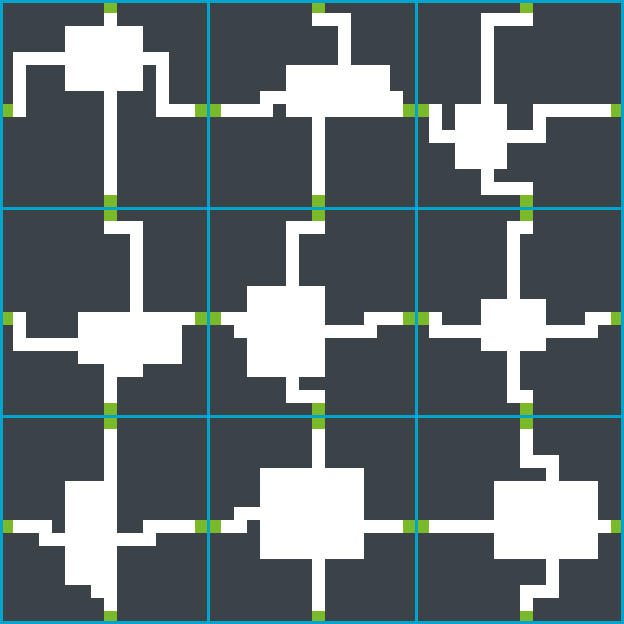

**LICENCIATURA EN DESARROLLO DE VIDEOJUEGOS Y SIMULACIÓN**

Simulación I · Primer parcial · 2026

**Documento de diseño técnico**

Raycasting sobre grilla con DDA y generación procedural

de mazmorras por chunks

**Integrantes** Juan Manuel Gelay · Alejo Hutmacher

**Profesor** Facundo Toufick Saiegh

Hurlingham, provincia de Buenos Aires, 29 de septiembre de 2026  
Actualizado el 13 de octubre de 2026 (feedback profesor)

# 1. Introducción
## 1.1 Contexto y consigna
Este documento es el diseño técnico del proyecto de la materia **Simulación I**, de la Licenciatura en Desarrollo de Videojuegos y Simulación de la Universidad Nacional de Hurlingham, 2026. El grupo de trabajo está formado por Juan Manuel Gelay y Alejo Hutmacher.

La consigna pide describir dos algoritmos de simulación y justificar su uso dentro de un proyecto propio. Elegimos dos que se necesitan mutuamente: **raycasting sobre grilla con DDA**, que convierte un mapa en grilla en una vista en primera persona, y **generación procedural de mazmorras por chunks**, que produce ese mapa a medida que el jugador lo recorre. Los dos se implementan en JavaScript clásico con PixiJS v8, en un proyecto que se abre con doble clic en index.html, sin instalar nada y sin levantar un servidor.

## 1.2 Resumen del proyecto
El proyecto es un juego de exploración y supervivencia en primera persona. Toda la lógica espacial vive en un mapa bidimensional en grilla, visto desde arriba, pero la vista del jugador se renderiza en primera persona mediante raycasting, emulando el estilo clásico de Wolfenstein 3D.

El escenario es una **mazmorra generada proceduralmente en tiempo de ejecución**. El mundo no tiene bordes: se arma por bloques a medida que el jugador avanza, así que el jugador puede caminar en cualquier dirección, incluso hacia coordenadas negativas, sin encontrar nunca un límite del mapa.

## 1.3 Alcance mínimo y alcance deseable
Separamos dos niveles de ambición para que la entrega no dependa de terminar todo.

El **alcance mínimo** es lo que nos comprometemos a entregar: recorrer en primera persona una mazmorra infinita generada proceduralmente, con colisiones contra las paredes y un minimapa, dibujado con colores planos. El capítulo 7 lo desglosa en fases y criterios de éxito.

El **alcance deseable** son las extensiones que se implementan solo si el alcance mínimo cierra con tiempo de sobra: combate, enemigos con máquina de estados, un jefe que define la victoria, la muerte de los enemigos con manchas y un chorro de sangre, HUD completo, texturas en paredes, piso y cielorraso con una estética nocturna inspirada en los edificios de la universidad, iluminación, un filtro CRT, menús con ranking y un panel de administración. El capítulo 2.3 las describe. Ninguna de ellas condiciona la entrega.

# 2. Descripción del juego
## 2.1 Bucle de juego
El jugador aparece en el centro de una sala y explora la mazmorra en primera persona. En el alcance mínimo no hay condición de victoria ni de derrota: el bucle es caminar, girar y orientarse con el minimapa. El alcance deseable suma las dos condiciones. La partida se pierde cuando la vida del jugador llega a cero. Se gana al matar al jefe, que aparece cuando el jugador eliminó a todos los enemigos comunes de la partida, 20 por defecto (2.3.2). Al terminar, con victoria o con derrota, el juego muestra el puntaje y el ranking de partidas anteriores (2.3.4).

## 2.2 Controles del jugador
El jugador se maneja con el teclado y el mouse:

- **W / S** o **flechas arriba / abajo**: desplazamiento del personaje hacia adelante y hacia atrás, en la dirección en la que mira.

- **A / D**: desplazamiento lateral hacia la izquierda y hacia la derecha, sin girar, para avanzar con cautela o asomarse a una puerta sin perder de vista lo que hay adelante.

- **Flechas izquierda / derecha**: rotación de la cámara sobre su propio eje, a izquierda y a derecha.

- **Movimiento horizontal del mouse**: la misma rotación, hacia el lado al que se mueve el mouse.

- **Movimiento vertical del mouse**: mirar hacia arriba y hacia abajo, dentro de un límite (3.4).

- **Barra espaciadora** o **clic izquierdo**: disparo (2.3.1).

- **R** o **clic derecho**: recarga (2.3.1).

El mouse se captura con la Pointer Lock API del navegador: el puntero se oculta y cada evento informa cuántos píxeles se movió el mouse (movementX), aunque el puntero esté contra el borde de la pantalla. El navegador concede la captura solo como respuesta a un clic, así que el primer clic sobre el juego dispara y además la pide. Esc libera el mouse, y abrir el panel de administración (2.3.5) también, para poder usar sus campos; el clic siguiente sobre el juego vuelve a disparar y a capturarlo. Los clics sobre el panel nunca disparan ni recargan, y los clics sobre las pantallas de menú, victoria y derrota (2.3.4) tampoco capturan el mouse, ni disparan ni recargan: el mouse se captura recién durante la partida, con un clic sobre la vista. Al capturarlo, el navegador muestra su propio aviso para liberarlo con Esc, que la página no puede ocultar ni cambiar de estilo. Mientras se juega con el mouse libre, un aviso del juego, dentro de su marco y arriba al centro, indica que un clic sobre la vista lo captura.

Así quedan dos esquemas que conviven: las flechas solas, que avanzan y giran como en los juegos de raycasting de los noventa, y W, A, S y D con el mouse, el esquema de los juegos en primera persona posteriores.

Ninguno de los dos cambia el estado de la cámara, que sigue siendo un vector dirección y un vector plano, ni el raycaster: sumar entradas cambió solo de dónde salen el giro y el desplazamiento. Girar, con las flechas o con el mouse, es aplicar la misma matriz de rotación a dir y plane. Con el mouse, el ángulo sale del movimiento horizontal del mouse en ese cuadro y no se multiplica por deltaTime, porque el movimiento del mouse ya es una distancia: en un cuadro más largo el mouse recorre más píxeles y el giro crece en la misma proporción. La sensibilidad se configura en el panel, en grados por cada 100 píxeles de movimiento (2.3.5). El desplazamiento lateral usa la dirección perpendicular a dir hacia la derecha, que sale de los mismos números sin guardar nada nuevo (6.6).

El movimiento vertical del mouse usa la misma sensibilidad: un píxel de mouse inclina la mirada el mismo ángulo hacia arriba que hacia el costado. Mover el mouse hacia arriba mira hacia arriba, sin opción de invertirlo. El ángulo vertical se guarda junto al jugador, limitado a unos 16,7 grados hacia cada lado, y en cada cuadro se convierte en los píxeles que se corre el horizonte (3.4), así un cambio de tamaño de la ventana lo conserva. Funciona caminando o quieto, la mira sigue fija en el centro y una partida nueva nivela la mirada. Dir y plane no cambian: cada rayo sigue en el plano del mapa.

## 2.3 Alcance deseable: posibles extensiones
### 2.3.1 Combate y supervivencia
- **Sistema de vida**: el jugador tiene una barra de salud. Recibir daño de un enemigo al colisionar disminuye ese valor, y si llega a cero el jugador muere y pierde la partida. La vida se cuenta en puntos, igual que la del enemigo y la del jefe: el jugador tiene 10. El daño por contacto llega en golpes enteros: un enemigo común pega un punto apenas toca al jugador y después uno por segundo mientras dure el contacto. Cada enemigo lleva su propia espera de un segundo entre golpes, así entrar y salir del contacto no suma golpes, y dos enemigos pegan el doble. En el mismo cuadro del golpe la barra baja un punto y la pantalla hace un destello rojo (2.3.3). El jugador camina más rápido de lo que persigue el enemigo, 3,1 contra 2 celdas por segundo, así que retroceder siempre lo aleja y lo saca del contacto antes del golpe siguiente.

- **Armamento y disparo**: el jugador dispone de un arma de fuego que se dispara con la barra espaciadora o con el clic izquierdo (2.2), apuntando con una mira fija en el centro de la pantalla. Hay un segundo de espera entre disparos exitosos; los intentos durante la espera no se encolan. Cada disparo lanza un proyectil visible que sale del jugador en la dirección de la mira. Como la mira está fija en el centro, esa dirección es la del rayo de la columna central: cameraX vale 0 y rayDir es igual a dir. Al disparar, ese rayo recorre la grilla celda por celda con el mismo DDA del capítulo 3 y devuelve la distancia a la primera pared, que pasa a ser el alcance del proyectil. Como las paredes no cambian durante la partida, ese alcance no se vuelve a calcular, y el proyectil nunca pasa de la cara de esa pared. En cada cuadro el proyectil avanza a 20 celdas por segundo, multiplicadas por deltaTime (6.4), y se revisa el tramo que recorrió en ese cuadro. Cada enemigo queda registrado en la celda que ocupa, así solo se revisan los enemigos de las celdas que toca ese tramo, ampliado medio ancho de enemigo hacia cada lado para encontrar también a uno con el centro en la celda vecina y el cuerpo sobre el tramo. Un enemigo recibe el impacto si su centro, proyectado sobre la dirección del disparo con el producto punto, cae dentro del tramo, y si su distancia a la línea del disparo no supera la mitad de su ancho. Si el tramo alcanza a más de uno, el impacto es para el más cercano: el proyectil desaparece y ese enemigo pierde un punto de vida. Un enemigo común tiene un solo punto, así que muere con un disparo, y cada muerte suma uno al contador de enemigos eliminados; el jefe necesita varios impactos (2.3.2). Si el proyectil llega a su alcance, choca contra la pared y desaparece, así una pared más cerca que el enemigo bloquea el disparo; si no había pared dentro de la distancia máxima del rayo, desaparece al recorrerla. Como el impacto se decide durante el vuelo, un enemigo que se corre a tiempo esquiva el disparo. La mira marca también la altura del disparo. El proyectil sale a la altura de los ojos, a media celda del piso, y sube o baja con la mirada (3.4): por cada celda que avanza sobre dir gana pitch / alturaPantalla celdas de altura, la tangente del ángulo vertical, así recorre la línea que pasa por la mira. Su alcance es el menor entre la distancia a la pared que da el DDA y la distancia a la que esa línea llega al piso (altura 0) o al cielorraso (altura 1), 0,5 dividido por esa pendiente. Con la mirada nivelada la pendiente vale 0, la división da Infinity en JavaScript, como deltaDist en un rayo paralelo a un eje (3.3), y gana la pared sin ningún caso especial. Un enemigo recibe el impacto solo si, donde el proyectil cruza su centro, la altura del proyectil cae dentro de su cuerpo, entre 0 y su altura: 0,6 celdas el común y 0,9 el jefe. Así un disparo que pasa por encima de la cabeza de un enemigo común sigue de largo y puede dar en el jefe que está detrás. Mientras el jugador camina, el disparo sale de la posición y la altura reales, sin el balanceo de los pasos (6.6). En la vista en primera persona el proyectil es un pequeño cuadrado rojo anaranjado dibujado a su altura, que sube o baja en pantalla con la mira, proyectado como los enemigos y oculto detrás de las paredes más cercanas; en el minimapa es un punto del mismo color.

- **Muerte de un enemigo**: un enemigo que pierde su último punto de vida sale del juego en ese mismo cuadro. Deja su celda y su chunk, así ya no bloquea, no pega por contacto ni recibe disparos, y la baja se cuenta en el momento. Lo que queda es su imagen, que se dibuja pero no participa de la simulación: cae donde murió con los cinco cuadros de muerte de su sprite (2.3.2), uno cada 0,2 segundos, queda tendido 2 segundos en el último y se desvanece en el último medio segundo. Después del cuerpo queda solo la mancha de sangre de su celda (2.3.2), así el mapa infinito no se llena de cuerpos. El jefe cae con los mismos cuadros, teñido de carmesí y a su tamaño. Matarlo gana la partida en ese cuadro, por eso mientras cae ningún enemigo golpea al jugador, y la pantalla de victoria aparece cuando termina de caer, un segundo después. En el modo de colores planos, que muestra el algoritmo desnudo, el enemigo desaparece en el cuadro en que muere.

- **Gestión de munición**: el cargador tiene capacidad limitada, seis balas por defecto, así que el jugador debe recargar cada cierta cantidad de disparos. Las recargas son infinitas por defecto, para favorecer un ritmo constante. El panel de administración (2.3.5) puede limitarlas: entonces un contador junto a la munición muestra cuántas quedan, y con el cargador y las recargas agotados la escopeta deja de disparar.

### 2.3.2 Enemigos y comportamiento
La mazmorra estaría habitada por un tipo de enemigo común y un jefe, controlados por la misma **máquina de estados**. En la vista en primera persona el enemigo es un sprite: el cuadro frontal de Husk Mutant, de HorrorMovieRei, una imagen de 33 por 57 píxeles con licencia CC0 embebida como data URI (6.2). Se proyecta con la inversa de la matriz que forman plane y dir, como en la parte 3 de Lode, elige en cada franja su columna de textura, como las paredes, y solo se dibuja en las franjas donde está más cerca que la pared. Los enemigos cercanos tapan a los lejanos, y su brillo baja con la distancia en las mismas bandas que las paredes. En el modo de colores planos vuelve a ser un rectángulo ámbar. Del mismo archivo salen los cinco cuadros de muerte (2.3.1), empaquetados en una sola tira de cuadros de 51 por 60 píxeles, también embebida como data URI. Mantienen la escala del cuadro frontal, 57 píxeles por cada 0,6 celdas, así el cuerpo conserva su tamaño al caer. En cada cuadro el píxel más bajo se apoya en la base, que es la línea del piso, y el ancla horizontal del dibujo queda en la misma posición que en el cuadro frontal, así el cuerpo no flota ni salta de costado.

Cada enemigo que muere deja una **mancha de sangre** en el piso de su celda, la que da Math.floor de su posición. La mancha se guarda durante toda la sesión en el chunk de esa celda, con la misma estructura que las paredes (6.8): al alejarse y volver, sigue en el mismo lugar. Hay una sola por celda, y si otro enemigo muere en una celda manchada queda la primera. Es una mancha rojo oscuro centrada en su celda, con una de cuatro formas elegida por un número pseudoaleatorio calculado a partir de la semilla del mundo y de la celda, así la misma semilla da las mismas manchas. Se dibuja con el floor casting (6.5), que ya calcula la celda de cada punto del piso, con la misma luz y las mismas bandas de distancia que el piso. En el minimapa cada celda manchada lleva un punto rojo oscuro: es la prueba visible de que la celda quedó guardada, como el minimapa lo es del DDA. Una partida nueva o un mundo nuevo borran todas las manchas. El modo de colores planos no las dibuja en la vista en primera persona, y el minimapa las sigue marcando, como a los enemigos.

Cada impacto lanza además un **chorro de sangre** desde el pecho del enemigo, 6 gotas por impacto y 24 al morir. El chorro es un sistema de partículas: cada gota guarda su posición en el mundo (x, y y una altura z), su velocidad y el tiempo de vida que le queda. En cada cuadro la gravedad se suma a la velocidad y la velocidad a la posición, las dos multiplicadas por deltaTime, que hace de paso del método de Euler (3.5). Una gota desaparece al llegar al piso, con z igual a 0, o al agotar su tiempo de vida, y no deja mancha: la mancha sale solo de la celda de la muerte. Las gotas se proyectan como los enemigos, más arriba de la línea del piso según su altura, y se ocultan detrás de las paredes más cercanas; el minimapa no las muestra. Viven en un conjunto fijo de 256 gotas creado una sola vez (6.4), y cuando está lleno las gotas nuevas se descartan.

La partida tiene un total de enemigos comunes, 20 por defecto, que se ubican todos juntos al empezar en los cuatro chunks que comparten una puerta con el del jugador (arriba, abajo, izquierda y derecha), repartidos en partes iguales: con 20 quedan cinco por chunk. Cada enemigo ocupa una celda de aire distinta elegida al azar, primero entre las de las salas y, cuando las salas se llenan, entre las de los corredores. Ningún enemigo aparece donde el jugador podría verlo: la celda queda a más de 10 celdas de la del jugador, fuera de la ventana del minimapa (6.7), y sin línea de visión hacia él, comprobada con el mismo DDA que usa el enemigo para detectarlo. Así ninguno nace encima del jugador. El chunk del jugador queda vacío, y la partida arranca sin contacto. Si el total no entra en esos cuatro chunks, el resto ocupa los chunks de alrededor de a un anillo por vez, con la misma regla de visibilidad. Los chunks que se generan después, al explorar, no suman enemigos nuevos. Cada enemigo mide 0,6 celdas de alto y está apoyado en el piso: el ojo del jugador está a media altura de la pared, así que a una profundidad d la línea del piso queda alturaPantalla / (2d) por debajo del horizonte, y el enemigo sube desde ahí. El sprite toma el ancho que dan sus proporciones, unas 0,35 celdas, y el rectángulo del modo plano mide 0,3. En el minimapa los enemigos son de color ámbar. En el mapa ocupa un cuadrado de 0,3 celdas de lado: con esa huella se desliza por eje contra las paredes, igual que el jugador, y su cuerpo nunca las atraviesa. Al perseguir, el enemigo se acerca hasta quedar de frente al jugador, a 0,5 celdas de su centro, y ahí se detiene: los dos cuerpos suman 0,35 celdas, así que entre ellos siempre queda espacio. El paso de cada cuadro se recorta a lo que falta para esa distancia, y desde ahí ya está en contacto, que llega hasta 0,6 celdas (2.3.1). Dos enemigos tampoco se superponen: el paso de un enemigo en cada eje se rechaza si dejaría su cuerpo encima del de otro, y solo se revisan los enemigos registrados en las celdas vecinas. Así varios perseguidores se reparten alrededor del jugador. Su registro por celda se conserva durante la sesión. En cada cuadro solo se actualizan y se dibujan los enemigos del área activa, los 5 por 5 chunks alrededor del chunk del jugador, que cubren la distancia máxima del rayo. Cada enemigo figura en la lista del chunk donde está parado y cambia de lista al cruzar una frontera, así el área activa se arma con a lo sumo 25 consultas al Map y su costo no crece con lo explorado, igual que el del render (3.6). Cuando el jugador entra a otro chunk, los enemigos vivos que quedaron fuera de juego reaparecen en reposo en los cuatro chunks con puerta al nuevo, con las mismas reglas del comienzo, cada uno en el chunk que tenga menos enemigos. Un enemigo queda fuera de juego cuando no está en el chunk del jugador ni en esos cuatro, no lo persigue y el jugador no podría verlo. Así los que siguen vivos, el jefe incluido, quedan siempre a una puerta de distancia en el mapa infinito, y el jugador nunca ve desaparecer a uno. Si no hay celdas libres, esperan quietos donde estaban.

Los estados previstos son:

- **Reposo**: el enemigo permanece estático en su zona.

- **Patrulla**: movimiento automático dentro de un área definida.

- **Persecución**: al detectar al jugador mediante una comprobación de línea de visión, que es un raycast contra el mismo mapa, el enemigo abandona la patrulla, persigue al jugador y le inflige daño por contacto.

Cuando el jugador elimina al último enemigo común de ese total, aparece un único **jefe**, con las mismas reglas que los enemigos comunes: en una sala de uno de los cuatro chunks con puerta al del jugador, fuera de su vista. Usa la misma máquina de estados y las mismas velocidades que un enemigo común, mide una vez y media su tamaño (0,45 por 0,9 celdas), es de color carmesí (en la vista en primera persona, el mismo sprite del enemigo teñido de ese color y dibujado a su tamaño), tiene cinco puntos de vida, así que necesita cinco impactos para morir, y cada uno de sus golpes quita dos puntos, el doble que los de un enemigo común. Matar al jefe gana la partida, y la pantalla de victoria espera a que termine de caer (2.3.1).

Vale la pena notar que la línea de visión del enemigo y el alcance del proyectil del jugador reutilizan el mismo recorrido DDA del capítulo 3. El render, la percepción de la IA y el punto donde el disparo choca contra la pared salen del mismo código con distinto propósito. La iluminación también lo reutiliza: el rayo de sombra de cada luz es otro recorrido DDA (2.3.6).

### 2.3.3 Elementos en pantalla
La vista en primera persona se acompaña de un HUD minimalista con seis elementos superpuestos:

- **Mira**: elemento central estático para apuntar durante el combate.

- **Barra de vida**: indicador del estado de salud actual, en la esquina superior izquierda, con la etiqueta LIFE.

- **Contador de munición**: disparos restantes antes de tener que recargar, debajo de la vida, con la etiqueta AMMO. Si el panel limita las recargas, a la derecha de la barra se lee cuántas quedan, en la forma x3.

- **Contador de enemigos eliminados**: debajo de la munición, en la forma KILLS 3 / 20, donde 20 es el total de enemigos comunes de la partida, para que el jugador sepa cuánto le falta para que aparezca el jefe.

- **Minimapa**: representación reducida del mapa 2D sobre el que se renderiza el entorno, en la esquina superior derecha. Sirve a la vez como herramienta de orientación para el jugador y como validación visual del motor lógico. Es el único de los seis elementos que forma parte del alcance mínimo.

- **Destello de daño**: elemento no diegético, que el jugador ve pero que no existe dentro del mundo del juego. Con cada golpe los bordes de la pantalla se tiñen de rojo, un rojo que se vuelve transparente hacia el centro, y el destello se apaga en 0,4 segundos, así cada golpe es un único pulso. Es una imagen con un degradado radial, dibujada una sola vez en un canvas oculto y estirada a la pantalla; en cada cuadro solo cambia su opacidad. Queda por encima de la vista y de la escopeta y por debajo de las barras y el minimapa, así la vida se sigue leyendo.

Las etiquetas son objetos Text de PixiJS con una fuente monoespaciada del sistema, así no hay ningún archivo de fuente que cargar.

Debajo del HUD, la escopeta ocupa la parte inferior de la vista, ubicada de modo que el eje del caño, prolongado, cruza la mira. Mirar arriba o abajo no la mueve. Al caminar se balancea con los pasos del jugador (6.6), al mismo ritmo que la cámara: baja un 1,5 % del alto de la pantalla en cada pisada y se corre hasta un 2 % hacia el pie de apoyo, un vaivén de lado a lado por zancada. Al quedarse quieto vuelve a su lugar en 0,2 segundos, y las animaciones de disparo y recarga siguen funcionando mientras camina.

### 2.3.4 Pantallas, puntaje y ranking
Al abrir el juego se muestra el menú principal, con el nombre del juego, Hurlinstein3D, y tres botones: iniciar partida, controles y créditos. Controles lista las teclas y el mouse (W y S o las flechas arriba y abajo para avanzar y retroceder, A y D para el desplazamiento lateral, las flechas izquierda y derecha o el mouse para girar, el mouse también para mirar arriba y abajo, espacio o clic izquierdo, R o clic derecho, y P para el panel de administración). Créditos nombra al equipo, la materia, la universidad, el profesor, PixiJS y el origen y la licencia de cada imagen. Las dos pantallas tienen un botón para volver al menú.

Cada partida arranca con un mundo nuevo: se descartan los chunks, los enemigos, los que todavía caen, las manchas, las gotas y los proyectiles en vuelo de la anterior, y el jugador vuelve al spawn con la vida y el cargador completos. Dentro de una partida los chunks se conservan como indica 4.4.

El juego pasa por cuatro estados: menú, en juego, victoria y derrota. El jugador, los enemigos y los proyectiles se actualizan solo en juego. En los otros estados la escena queda quieta detrás de la pantalla que corresponde.

Al ganar o al perder aparece una pantalla con el resultado, los enemigos eliminados, el tiempo de juego, el puntaje obtenido, el ranking y dos botones: jugar de nuevo y volver al menú. Las pantallas completas se pueden navegar con las flechas arriba y abajo, o con W para subir y S para bajar; Enter o Space activa el botón enfocado. Al abrir una pantalla, se enfoca su primer botón y se libera la captura del mouse. Mientras el foco está en el campo de iniciales, las teclas se ingresan normalmente. El puntaje suma 100 puntos por cada enemigo común y 1000 por el jefe. Al terminar, el jugador ingresa tres iniciales y la partida se envía a una API externa; el ranking muestra las cinco mejores puntuaciones que devuelve esa API, cada una con su nombre, puntaje y fecha. La API es la única fuente del ranking: no se guarda nada en el navegador. Si la API no responde, la pantalla muestra el error y el juego sigue funcionando.

Los menús y las pantallas son elementos HTML superpuestos al canvas, dentro del mismo marco que lo escala (2.3.5). Así tienen botones reales y acompañan el tamaño de la ventana.

### 2.3.5 Panel de administración
El juego ocupa toda la ventana en cualquier pantalla (6.5). Sobre él hay un panel de administración en HTML para el equipo, que sirve para configurar cómo se juega y para mostrar el motor en la defensa. Arranca oculto. Al acercar el mouse al borde superior baja un zócalo centrado con el botón Open admin panel, que se vuelve a esconder cuando el mouse se aleja. Al hacer clic, el panel baja a todo el ancho y queda fijo hasta cerrarlo con la X de arriba a la derecha, con el botón Close admin panel de abajo o con la tecla P, que también lo abre. El panel se superpone al juego sin achicarlo ni pausarlo, así los valores cambian a la vista mientras se juega. Abrirlo libera el mouse capturado (2.2). Sus íconos son de la familia Lucide, embebidos como SVG en index.html.

El panel muestra datos en vivo, actualizados unas cuatro veces por segundo: cuadros por segundo, posición del jugador, chunk actual, vida, munición, enemigos vivos sobre el total de la partida, enemigos en el área activa (2.3.2), cantidad de chunks cargados y semilla del mundo (4.4). También tiene configuraciones editables, cada una con su rango indicado junto al campo. Se aplican en el momento y se guardan en localStorage para la próxima vez; el botón Reset vuelve a los valores por defecto, y si el navegador bloquea localStorage se usan esos mismos valores. Las configuraciones son:

- **Partida**: el total de enemigos comunes, entre 1 y 100.000, 20 por defecto, que al cambiarse reemplaza a los enemigos vivos por el total nuevo alrededor del jugador y que con un número enorme sirve para medir memoria y rendimiento; el área activa (2.3.2), que se puede apagar para comparar los cuadros por segundo con la misma cantidad de enemigos; y los puntos de vida del jugador (10), del enemigo común (1) y del jefe (5).

- **Arma**: el tamaño del cargador, entre 2 y 20 balas, y las recargas, sin límite o con un tope entre 0 y 99.

- **Jugador**: la velocidad de giro con las flechas izquierda y derecha en grados por segundo, 120 por defecto; la sensibilidad del mouse en grados por cada 100 píxeles de movimiento, entre 5 y 100, 20 por defecto (2.2); la invulnerabilidad; la mirada vertical con el mouse (3.4) y el balanceo de los pasos (6.6). Las dos últimas están encendidas por defecto: apagadas, la vista vuelve a la del raycasting clásico, para compararlas en la defensa o para jugadores propensos al mareo.

- **Raycasting**: el ancho de franja, de 1, 2, 4 u 8 píxeles, que cambia la cantidad de rayos por cuadro (6.5); el ojo de pez, que dibuja las paredes con la distancia euclídea en lugar de distPerp para mostrar la curva que describe 3.4; y los rayos sobre el minimapa, uno de cada ocho, que muestran hasta dónde llegan los rayos del DDA en ese cuadro.

- **Generación procedural**: un campo para la semilla y el botón New world, que arranca una partida nueva en el mundo de esa semilla, o de una al azar si el campo queda vacío (4.4); al terminar, el campo muestra la semilla en uso, para poder compartirla. También las fronteras de los chunks dibujadas sobre el minimapa.

- **Render**: las texturas de paredes, piso y cielorraso, la iluminación, el modo de colores planos y el filtro CRT (2.3.6). Apagarlos de a uno sirve para mostrar cada técnica por separado en la defensa.

Suma dos acciones más: recargar la munición y hacer aparecer al jefe. Si el jefe ya está vivo, el botón lo trae a una sala de los cuatro chunks con puerta al del jugador, con las mismas reglas de aparición, así nunca hay dos. La caja Partida, la semilla y New world funcionan solo durante la partida: en el menú y en las pantallas de victoria y derrota quedan desactivados. Mientras se escribe en un campo del panel, las teclas del juego quedan sin efecto.

### 2.3.6 Dirección de arte: UNAHUR de noche
La mazmorra toma como referencia los edificios de la Universidad Nacional de Hurlingham, imaginados de noche. Todas las texturas se dibujan por código en canvas ocultos (6.2): las fotos de los edificios sirvieron solo de referencia y ninguna entra al proyecto.

- **Paredes**: tres texturas. Revoque blanco con una franja verde y celeste cerca del piso, una banda de ventanas cubierta por celosías negras horizontales y paños vidriados altos entre marcos. Cada celda de pared elige la suya con un número pseudoaleatorio calculado a partir de sus coordenadas, así la misma pared se ve siempre igual, también en coordenadas negativas. El color del chunk y el sombreado las tiñen.

- **Piso y cielorraso**: baldosas claras con juntas oscuras abajo y paneles blancos en grilla arriba, alineados a la grilla del mundo, así se deslizan bajo el jugador cuando camina y giran con la cámara. Se dibujan con floor casting (6.5).

- **Luz**: la luz ambiente es baja y cada sala tiene una luz en su centro. Cada luz ilumina las paredes que la miran, con una intensidad que baja con la distancia, y un rayo de sombra, que es el mismo DDA del capítulo 3, decide si otra pared la tapa. También ilumina el piso y el cielorraso a su alrededor, con la misma caída y sin rayo de sombra, que costaría un rayo por píxel. En el cielorraso, cada luz se ve como una luminaria fluorescente, un panel claro sobre su celda. Una de cada cinco luminarias parpadea: cada cuatro segundos se atenúa dos veces, y con ella su luz sobre las paredes. La elección depende de la posición de la luminaria, así la misma parpadea siempre.

- **Distancia**: los enemigos se oscurecen con la distancia en cuatro bandas, y con la iluminación apagada también las paredes, el piso y el cielorraso, hasta quedar casi negros cerca del tope de distancia del rayo. Más allá del tope se ve el color de fondo, un azul casi negro.

- **Filtro CRT**: sobre la vista en primera persona va un filtro de posprocesado que imita un monitor de tubo, con líneas de barrido, una curvatura leve, viñeta y un poco de ruido que se mueven con el tiempo. El minimapa, el HUD y las pantallas HTML quedan fuera del filtro y se leen nítidos. Es el CRTFilter de la biblioteca pixi-filters (6.2).

Cada parte se puede apagar desde el panel (2.3.5). Con todo apagado, la vista vuelve a los colores planos del alcance mínimo (1.3).

# 3. Algoritmo 1: raycasting sobre grilla con DDA
## 3.1 Qué resuelve
El raycasting convierte un mapa 2D en grilla en una vista en primera persona lanzando un rayo por cada columna de la pantalla. Todo el cálculo es de dos dimensiones, y por eso se lo llama pseudo 3D: la sensación de profundidad sale de la distancia medida hasta cada pared, no de una escena tridimensional. En este documento el término nombra siempre esa técnica de render, distinta del raytracing de los gráficos realistas.

Lo elegimos por dos motivos. Primero, porque el costo no depende del tamaño del mundo, lo que hace compatible el render con una mazmorra infinita. Segundo, porque el algoritmo trabaja directamente sobre la grilla de celdas que produce el generador, sin ninguna capa de conversión entre los dos sistemas.

## 3.2 Modelo de cámara
El jugador tiene una posición pos, un vector dirección dir y un vector plane perpendicular a dir que representa el plano de la pantalla visto desde arriba. El largo de plane respecto del de dir define el campo de visión, que queda implícito: vale 2 \* atan(\|plane\|) con dir de largo 1, y el motor no lo guarda en ninguna variable.

El largo de plane sale de la forma del canvas: **\|plane\| = ancho / alto / 2**. La razón es la proyección de 3.4. Una pared a distancia perpendicular d mide alto / d píxeles de alto, y una celda a esa distancia ocupa ancho / (2 \* \|plane\| \* d) píxeles de ancho. Las dos medidas coinciden, y una cara de pared se ve cuadrada, solo con ese largo. En una pantalla 4:3 da 0,66, el valor de Lode, y el campo de visión ronda los 66 grados. En 16:9 da 0,89 y unos 83 grados. Lo que se ve de alto no cambia con la pantalla: una pantalla más ancha muestra más hacia los costados, que es el criterio habitual de los juegos en primera persona para pantallas anchas. El largo se recalcula con una división solo cuando cambia el tamaño del canvas, nunca por cuadro.

Por cada columna x de la pantalla se calcula:

**cameraX = 2 \* x / ancho - 1**

Ese valor va de -1 en el borde izquierdo de la pantalla a +1 en el derecho, y con él la dirección del rayo queda:

**rayDir = dir + plane \* cameraX**

rayDir apunta a un punto del plano de cámara y se usa con el largo que le da esa suma, sin normalizar. Para girar, dir y plane se rotan el mismo ángulo con una matriz de rotación, así se mantienen perpendiculares y el campo de visión no cambia.

## 3.3 Recorrido del rayo con DDA
El DDA (Digital Differential Analyzer) salta de una línea de la grilla a la siguiente. Cada iteración cruza exactamente un borde de celda, así que el rayo visita todas las celdas que atraviesa, sin saltearse ninguna y sin muestrear de más.

mapX y mapY arrancan en la celda del jugador. Por rayo se precalculan:

- deltaDistX = 1 / \|rayDirX\| y deltaDistY = 1 / \|rayDirY\|: lo que recorre el rayo entre una línea vertical de la grilla y la siguiente, y entre una horizontal y la siguiente. Son constantes por rayo: se calculan una vez, antes del bucle, y no cambian durante el recorrido.

- **Por qué el numerador es 1.** La fórmula geométrica es \|rayDir\| / \|rayDirX\|, que da distancia euclídea. Poner 1 en su lugar equivale a medir todo en unidades de \|rayDir\| en vez de en unidades de mundo. El DDA no se entera, porque los dos ejes quedan escalados por el mismo factor y la comparación entre ellos no cambia. Pero la simplificación hace algo mejor que no romper nada: como dir mide 1 y plane es perpendicular a dir, esa unidad escalada **es** la distancia perpendicular al plano de cámara. El bucle entrega gratis el número que necesita la proyección de la sección 3.4, sin ninguna conversión posterior.

- **Por qué la división por cero no rompe nada.** Un rayo perfectamente vertical no cruza ninguna línea vertical de la grilla, ni a diez celdas ni a mil. Su deltaDistX es infinito de verdad, no por un error de cálculo. En JavaScript 1 / 0 da Infinity sin lanzar excepción, e Infinity nunca resulta menor que un valor finito, así que ese eje nunca gana la comparación y el rayo avanza siempre por el otro. El caso degenerado se resuelve solo, sin un if especial.

- sideDistX y sideDistY, las distancias desde la posición del jugador hasta la próxima línea vertical y hasta la próxima línea horizontal.

- stepX y stepY, que valen +1 o -1 según el signo de cada componente de la dirección.

El bucle compara los dos acumuladores, avanza en el eje del menor, mueve el índice de celda en ese eje, registra en side qué cara cruzó y corta cuando cae en una celda de pared o cuando supera la distancia máxima.

## 3.4 Proyección en pantalla
La altura de la franja que se dibuja en esa columna se calcula con la **distancia perpendicular al plano de cámara**, no con la distancia euclídea hasta el punto de impacto. Medida así, una pared recta se dibuja recta de un borde a otro de la pantalla. Con la distancia euclídea aparece el efecto ojo de pez, con las paredes curvadas hacia los bordes.

**alturaFranja = alturaPantalla / distPerp**

La franja se centra en el horizonte, a la mitad de la pantalla, y se recorta contra los bordes cuando la pared está muy cerca. La distancia perpendicular no hace falta calcularla aparte: se lee del estado final del DDA como sideDistX - deltaDistX o sideDistY - deltaDistY, según cuál fue el último eje en avanzar.

**Mirar hacia arriba y hacia abajo.** En la presentación de clase quedó entre las restricciones que el raycasting de Wolfenstein paga por su velocidad: la cámara no mira hacia arriba ni hacia abajo. El motor suma esa mirada de forma limitada con dos números de la parte de floor casting del tutorial de Lode. **pitch** es la cantidad de píxeles que baja el horizonte cuando el jugador mira hacia arriba, negativa cuando mira hacia abajo. **posZ** es cuánto está el ojo por encima de su altura de reposo, en píxeles: la diferencia en celdas por alturaPantalla; el balanceo de los pasos lo usa para bajar el ojo en cada pisada (6.6). Con ellos el horizonte queda en alturaPantalla / 2 + pitch y los bordes de la franja pasan a ser:

**inicio = -alturaFranja / 2 + alturaPantalla / 2 + pitch + posZ / distPerp**

**fin = alturaFranja / 2 + alturaPantalla / 2 + pitch + posZ / distPerp**

alturaFranja conserva su fórmula. Las dos líneas salen de una regla general: un punto a z celdas del piso, a distancia d sobre dir, se dibuja en la fila alturaPantalla / 2 + pitch + (posZ + alturaPantalla \* (0,5 - z)) / d, porque está 0,5 - z celdas por debajo del ojo y una celda a esa distancia mide alturaPantalla / d píxeles. La misma regla ubica el borde superior de la pared (z = 1), su pie (z = 0), la base de los enemigos, las gotas de sangre y el proyectil a su altura. Como posZ se divide por la distancia, una pared cercana se mueve más que una lejana, que es lo que da la sensación de que la cámara sube o baja.

La mirada se guarda como un ángulo y en cada cuadro se convierte en **pitch = alturaPantalla \* tan(ángulo)**. alturaPantalla es la distancia focal vertical de esta proyección, la misma que da alturaFranja = alturaPantalla / distPerp, así que un punto que está sobre la línea de la mirada cae justo en el centro de la pantalla, donde está la mira. Esta técnica se llama y-shearing (deslizamiento vertical): la imagen entera se corre hacia arriba o hacia abajo y las paredes siguen verticales. En una cámara que rota de verdad las verticales convergerían hacia un punto de fuga por encima o por debajo de la pantalla. Para ángulos chicos la diferencia casi no se nota, y por eso la mirada queda limitada: el horizonte se corre como mucho un 30 % del alto de la pantalla hacia cada lado, unos 16,7 grados. Mirar arriba y abajo no rompe el raycasting: cada rayo sigue en el plano 2D del mapa, el DDA no cambia y su costo tampoco. Cambia solo la fila donde se dibuja cada cosa.

## 3.5 Por qué cuenta como algoritmo de simulación
El motor simula cómo le llega la luz al ojo del jugador, con una muestra por columna de pantalla. Cada rayo resuelve dos preguntas sobre el mundo: qué pared es visible en esa dirección y a qué distancia está. El resultado no es una aproximación estética, es la respuesta geométrica exacta para esa dirección dentro del modelo discreto de la grilla.

El chorro de sangre (2.3.2) suma una simulación de otro tipo, en el tiempo: un sistema de partículas que integra el movimiento de cada gota con el método de Euler. Con un paso Δt, que es el deltaTime del ticker, cada cuadro calcula v = v + g · Δt y después p = p + v · Δt, donde g es la gravedad, que solo actúa sobre la altura. Es una aproximación de primer orden, cuyo error crece con el paso, y alcanza porque cada gota vive menos de un segundo y su trayectoria solo tiene que verse creíble.

## 3.6 Costo computacional
El trabajo por cuadro es proporcional a la cantidad de columnas multiplicada por la cantidad de celdas que cada rayo atraviesa hasta chocar o hasta llegar al tope de distancia. **El tamaño del mundo queda fuera de la cuenta**, y eso es exactamente lo que permite que el mundo sea infinito sin que el render se vuelva más caro.

El desarrollo extenso del tema, con los diagramas geométricos y el trazado de un DDA paso a paso, está en el material de apoyo del equipo, citado en el capítulo 8.

# 4. Algoritmo 2: generación procedural de mazmorras por chunks
## 4.1 Qué resuelve
El generador responde una sola pregunta, para cualquier par de coordenadas enteras: qué hay en esa celda. El valor 0 es aire y el 1 es pared.

El mundo se divide en **chunks de 16 por 16 celdas**. Cada chunk es un bloque de mazmorra con una sala y los corredores que la conectan con los cuatro chunks vecinos. Un chunk se genera la primera vez que se consulta alguna de sus celdas, y a partir de ahí queda guardado en memoria.

## 4.2 Generación de un chunk, paso a paso
1.  Se crea un arreglo de 16 por 16 celdas, todas pared.

2.  Se sortea una sala rectangular de entre 4 y 8 celdas de lado, ubicada con un margen de al menos dos celdas de pared contra cada borde del chunk, y se la talla en aire.

3.  Se fijan las cuatro puertas del chunk, siempre en la misma posición: la celda de índice 8 de cada borde.

4.  Cada puerta se une a la sala con un corredor de tres tramos rectos: sale de la puerta hacia adentro del chunk, dobla en una fila o columna sorteada entre el borde y la sala hasta alinearse con el centro de la sala, y entra derecho.

5.  El chunk terminado se guarda en el Map de chunks con una clave numérica única, calculada a partir de cx y cy (sección 6.8).



*Figura 1. Nueve chunks generados con este algoritmo. Las líneas celestes marcan las fronteras entre chunks y las celdas verdes son las puertas. Cada puerta queda pegada a la puerta del chunk vecino.*

## 4.3 Por qué el mundo siempre es transitable
Las puertas están en la misma posición en todos los chunks, así que la puerta este de un chunk queda pegada a la puerta oeste del chunk de al lado, y lo mismo en vertical. Dentro de cada chunk, la sala llega a sus cuatro puertas, y cada puerta lleva a la sala vecina. Encadenando chunks se llega desde cualquier sala a cualquier otra.

Lo importante del argumento es que **la conectividad sale de la construcción**: el generador arma cada chunk sin mirar a sus vecinos y sin recorrer el mapa después para verificar que no quedó una zona aislada. No hay ninguna pasada de validación ni ningún caso en el que haya que descartar un chunk y volver a sortearlo.

## 4.4 Por qué el mapa se mantiene estable durante la partida
Volver a una zona ya recorrida muestra exactamente el mismo mapa. Lo garantizan dos cosas: cada chunk se genera **una sola vez** y queda guardado en el Map, y el azar con el que se genera sale de una **semilla**, así que generarlo de nuevo daría las mismas celdas. En la segunda consulta ya no se genera nada, se lee lo que se escribió antes.

La memoria alcanza de sobra. Cada chunk ocupa 256 bytes, un Uint8Array de 16 por 16, y con el costo de la entrada en el Map quedan unos 350 bytes por chunk. Diez mil chunks entran en pocos megabytes, y diez mil chunks son un área de 100 por 100 chunks, es decir 1.600 por 1.600 celdas: mucho más de lo que un jugador recorre caminando en una sesión.

Cada mundo tiene una semilla, un entero de 32 bits elegido al azar al empezar la partida o escrito en el panel de administración (2.3.5). Un generador pseudoaleatorio chico, mulberry32, convierte una semilla en una secuencia de números entre 0 y 1, siempre la misma para la misma semilla, y el generador de chunks la usa en lugar de Math.random. Cada número sale de unas pocas operaciones con enteros.

Los chunks se generan en el orden en que el jugador los explora. Con una sola secuencia para todo el mundo, el chunk (1, 0) saldría distinto según el jugador fuera primero al este o al oeste, porque cada chunk generado antes consume números de la secuencia. Por eso cada chunk arranca su propia secuencia, con una semilla que mezcla la semilla del mundo con la clave de Cantor del chunk (6.8). El resultado: la misma semilla da el mismo mundo en cualquier orden de exploración, y dos computadoras con la misma semilla ven la misma mazmorra, como pasa en Minecraft. La ubicación inicial de los enemigos y sus patrullas usan otra secuencia, creada con la semilla del mundo, así una partida con la misma semilla también arranca con los enemigos en las mismas celdas.

El Map sigue guardando todos los chunks, ahora como caché: pesan muy poco y leer uno es más barato que tallarlo otra vez. La semilla ordena la generación y permite que los tests fijen un mundo y esperen un resultado exacto. Cada partida nueva arranca con otra semilla, y por lo tanto con otra mazmorra, salvo que el equipo escriba una en el panel.

## 4.5 Relación con la Unidad 1
De la unidad tomamos el manejo del mundo por chunks guardados en una **tabla hash con clave de coordenadas**, que en JavaScript es un Map cuya clave es un número único calculado a partir de cx y cy. La propiedad que nos interesa es que la memoria crece con lo explorado y queda independiente del tamaño del mundo, que es justamente lo que hace posible un mundo sin bordes.

## 4.6 Limitaciones que asumimos
La mazmorra tiene un patrón reconocible: una sala por chunk y pasos siempre en el medio de cada borde. La variedad sale del tamaño y la posición de cada sala y de los dobleces de los corredores, no de la topología general, que es siempre la misma.

Lo aceptamos a cambio de un generador corto que garantiza la conectividad por construcción. Si sobra tiempo, las primeras extensiones son un color de pared por chunk, que ayuda a orientarse, y una segunda sala por chunk.

# 5. Integración de los dos algoritmos
## 5.1 La interfaz getCell(x, y)
El punto de contacto entre el motor y el generador es una sola función: getCell(x, y). El raycaster la llama cientos de veces por cuadro, y las colisiones y el minimapa también la usan. **Todo lo que el motor sabe del mundo pasa por ahí.**

El módulo world la resuelve así: calcula el chunk con cx = Math.floor(x / 16) y cy = Math.floor(y / 16), convierte ese par en su clave numérica, lo busca en el Map, lo genera si todavía no existe, y devuelve la celda local. Generar un chunk es tallar una sala y cuatro corredores sobre 256 celdas, un trabajo tan chico que se hace en el momento, dentro del mismo cuadro, sin precargar nada.

Esa separación es la que hace viable el proyecto en el tiempo que tenemos: el motor se desarrolla contra un mapa escrito a mano detrás de la misma getCell, y el generador se enchufa después sin tocar una línea del renderer.

## 5.2 Invariantes del sistema
Para que los dos algoritmos convivan, el generador y el motor tienen que respetar seis invariantes.

| **Invariante**                             | **Por qué hace falta**                                                                                                                                                                                                                                                           |
|--------------------------------------------|----------------------------------------------------------------------------------------------------------------------------------------------------------------------------------------------------------------------------------------------------------------------------------|
| Tope de distancia por rayo                 | El bucle DDA termina al encontrar pared. En un mundo infinito un rayo puede enfilar por un corredor que cruza varios chunks, así que el bucle corta también a una distancia máxima, por ejemplo 24 celdas, y en esa columna, en el lugar de la pared, se dibuja una franja del color de fondo con la altura que tendría una pared en el tope. |
| Conversión de coordenadas con Math.floor   | El jugador puede ir hacia x o y negativas. Math.trunc y el operador \| 0 redondean hacia cero, y mandan -0,5 y 0,5 a la misma celda; además el operador % de JavaScript devuelve restos negativos. La celda sale de Math.floor, y la posición dentro del chunk, de x - cx \* 16. |
| getCell responde cualquier coordenada      | El DDA, las colisiones y el minimapa preguntan en cualquier dirección y sin aviso previo. Si el chunk todavía no existe, se genera en ese momento.                                                                                                                               |
| Bordes del chunk macizos salvo las puertas | Garantiza que las puertas de dos chunks vecinos siempre queden pegadas y que ningún corredor abra un hueco imprevisto en la frontera.                                                                                                                                            |
| Spawn en aire                              | El jugador arranca en el centro de la sala del chunk (0, 0), que siempre es aire. Si arrancara dentro de una pared, la distancia perpendicular tendería a cero y la altura de la franja se dispararía.                                                                           |
| Misma semilla, mismo mundo                 | Un chunk depende solo de la semilla del mundo y de sus coordenadas, nunca del orden de exploración (4.4). Así un chunk generado de nuevo sale idéntico, dos computadoras con la misma semilla ven la misma mazmorra y los tests pueden fijar una semilla y esperar un mapa exacto. |

## 5.3 La restricción de escala
En la dirección contraria, el motor le impone una restricción al generador: la escala. Una celda es una unidad de mundo y mide lo mismo de ancho que de alto, así que un pasillo de una celda se ve angosto y todas las paredes tienen la misma altura. El generador tiene que diseñar dentro de esa restricción: no puede pedir corredores más anchos en metros sin cambiar el tamaño del chunk, ni paredes de distinta altura sin cambiar el proyector.

# 6. Arquitectura técnica
## 6.1 Decisión: JavaScript clásico, sin build ni servidor
El proyecto es una carpeta que se abre con doble clic en index.html. PixiJS v8 y su biblioteca oficial de filtros, pixi-filters, son las únicas dependencias, y cada una va como un solo archivo dentro del proyecto: sin npm, sin bundler y sin servidor de desarrollo.

PixiJS se usa desde el objeto global PIXI que define pixi.min.js, el bundle de navegador de la versión 8, de unos 830 KB. Lo copiamos dentro del proyecto para que el juego funcione también sin internet. index.html carga cada archivo con un \<script\> clásico, en orden de dependencias y con main.js al final.

La decisión tiene un costo, que es no poder usar módulos ni cargar recursos externos, y un beneficio que para esta materia pesa más: el corrector abre el archivo y el juego anda, sin instalar nada.

## 6.2 Restricciones del protocolo file://
Abrir la página desde el disco impone dos reglas que condicionan toda la arquitectura:

- **Sin módulos ES.** Chrome bloquea los scripts con type="module" en file://, así que el proyecto no usa import ni export. Cada archivo declara sus funciones y constantes en el ámbito global, y el orden de los \<script\> resuelve las dependencias.

- **Sin recursos externos.** El navegador tampoco deja pedir archivos con fetch ni subir imágenes del disco a WebGL, por eso Assets.load falla en file://. El alcance mínimo dibuja solo colores planos y no carga ningún archivo externo. Si llegamos a las texturas, las generamos por código en un elemento canvas que nunca se muestra, así no hay ningún archivo que cargar. Por ejemplo, un cuadrado blanco que después se estira y se entinta, fragmentos de humo con ruido Perlin o un piso con ruido Worley. Así se dibuja la textura de la mancha de sangre (2.3.2). Una imagen hecha a mano puede ir embebida como data URI: el sprite del enemigo y la tira de sus cuadros de muerte van así.

- **Bibliotecas copiadas y cargadas en orden.** pixi-filters 6.1.5, con licencia MIT, trae el filtro CRT (2.3.6). Va copiada sin cambios en lib/pixi-filters.js, con su versión y su huella SHA-256 anotadas en el README, y se carga con un script clásico justo después de pixi.min.js, porque agrega sus filtros al global PIXI.filters.

La única petición de red del juego es la del ranking a la API externa (2.3.4). La restricción de file:// alcanza a los archivos del disco: un fetch a un servidor https funciona aunque la página se abra con doble clic, y si la API no responde el juego sigue sin ranking.

## 6.3 Estructura de archivos
```
proyecto/
  index.html
  lib/pixi.min.js
  js/config.js
  js/random.js
  js/mapgen.js
  js/world.js
  js/player.js
  js/raycaster.js
  js/renderer.js
  js/minimap.js
  js/main.js
```

| **Archivo** | **Responsabilidad**                                                                    | **Cuándo corre**                                   |
|-------------|----------------------------------------------------------------------------------------|----------------------------------------------------|
| config      | Constantes: tamaño de canvas, chunk, ancho de franja, tope de distancia, velocidades y colores | Se lee siempre                                     |
| random      | Generador pseudoaleatorio con semilla (mulberry32) y semilla de cada chunk (4.4)       | Cuando se genera un chunk                          |
| mapgen      | Genera un chunk: sala y corredores hacia las cuatro puertas                            | Cuando getCell pide un chunk que todavía no existe |
| world       | Map de chunks y getCell(x, y)                                                          | En cada consulta                                   |
| player      | pos, dir, plane, lectura de teclado y mouse, giro, mirada vertical, movimiento, colisiones, balanceo de los pasos y cámara que dibuja | Cada cuadro                                        |
| raycaster   | DDA por columna; devuelve distPerp y side                                              | Cada cuadro                                        |
| renderer    | Dibuja techo, piso y franjas de pared                                                  | Techo y piso planos una vez; con texturas, techo y piso cada cuadro; franjas cada cuadro |
| minimap     | Vista cenital de las celdas alrededor del jugador, con su posición y dirección         | Cada cuadro                                        |
| main        | Crea la aplicación, arma la escena y registra el ticker                                | Una vez al cargar                                  |

El alcance deseable suma lib/pixi-filters.js, cargado justo después de pixi.min.js (6.2), y estos archivos, también como scripts clásicos cargados en orden antes de main.js:

| **Archivo**  | **Responsabilidad**                                                                  |
|--------------|--------------------------------------------------------------------------------------|
| settings     | Configuraciones del panel: valores por defecto, rangos y guardado en localStorage     |
| enemies      | Máquina de estados, línea de visión, deslizamiento contra paredes, daño por contacto, impacto de un disparo y caída de los enemigos muertos |
| blood        | Manchas de sangre por celda, guardadas en el chunk de su celda (2.3.2)                |
| particles    | Chorro de sangre: conjunto fijo de gotas y paso de Euler (2.3.2, 3.5)                 |
| projectiles  | Proyectiles de la escopeta: alcance con el DDA del rayo central, el piso y el cielorraso, vuelo a la altura de la mira e impacto contra enemigos |
| hud          | Mira, barras de vida y munición, etiquetas y contador de enemigos eliminados          |
| weapon-sheet | Tira de cuadros de la escopeta embebida como data URI                                |
| weapon       | Escopeta apuntada a la mira, animación de disparo y de recarga, balanceo con los pasos |
| enemy-sheet  | Sprite del enemigo y tira de sus cuadros de muerte, embebidos como data URI           |
| game-state   | Estados de la partida, contador de enemigos eliminados y reinicio                    |
| ranking      | Puntaje, envío de la partida y lectura del ranking en la API externa (2.3.4)         |
| screens      | Menú principal, controles, créditos y pantallas de victoria y derrota                |
| admin        | Panel de administración con datos en vivo y controles                                |

## 6.4 Ciclo de ejecución y uso del ticker
La regla del motor es simple: **lo que se crea o se carga una sola vez va fuera del ticker, y dentro del ticker va solo lo que cambia en cada cuadro.**

Fuera del ticker van app.init, que es asíncrono y por eso main.js envuelve el arranque en una función async; los tres objetos Graphics (techo y piso, paredes, minimapa); la cámara que dibuja (6.8); los listeners de teclado y de mouse, que guardan qué teclas están apretadas, suman el movimiento horizontal y vertical del mouse y anotan los clics; y la ubicación del spawn. También el listener del tamaño de la ventana: cuando el ancho del canvas cambia no se crea ningún objeto, el canvas toma el ancho nuevo, plane se recalcula (3.2) y se vuelven a dibujar techo y piso y la mira. Las franjas texturizadas, el buffer de profundidad y el canvas oculto del piso y el cielorraso, con su textura y su sprite, se crean una sola vez para el ancho máximo con franjas de 1 píxel, así ni el tamaño de la ventana ni el ancho de franja crean objetos, y las franjas que sobran quedan ocultas. El filtro CRT también se crea una sola vez, y lo mismo las columnas de textura de los cuadros de muerte, la textura de la mancha de sangre y el conjunto de 256 gotas del chorro (2.3.2) con lo que las dibuja: dentro del ticker una gota solo cambia sus valores y se muestra u oculta.

Dentro del ticker van la lectura de teclas y del movimiento del mouse sumado desde el cuadro anterior, el giro, la mirada vertical y el movimiento con colisiones, la fase de los pasos, la copia del jugador en la cámara que dibuja con su pitch y su posZ, el corrimiento vertical del Graphics de techo y piso, la posición de la escopeta, el DDA por columna, los píxeles del piso y el cielorraso, el redibujo de paredes y minimapa, el avance de los enemigos que caen, el paso de Euler de las gotas y el tiempo del filtro CRT, que mueve sus líneas y su ruido. Las velocidades se multiplican por ticker.deltaTime, que vale cerca de 1 a 60 cuadros por segundo, para que el movimiento sea igual con cualquier tasa de cuadros. El giro con el mouse queda fuera de esa regla, porque el movimiento del mouse en un cuadro ya es una distancia (2.2).

## 6.5 Render
En el modo de colores planos, el techo y el piso son dos rectángulos en un Graphics que se dibuja una sola vez. Los dos se extienden más allá de los bordes de la pantalla, arriba y abajo, tanto como el corrimiento máximo del horizonte (3.4), así en cada cuadro solo se mueve el Graphics pitch píxeles y el borde nunca queda a la vista. Las paredes van en otro Graphics que arranca cada cuadro con clear() y dibuja un rect() por columna. Las columnas del mismo color se acumulan y se pintan con un solo fill(), así cada cuadro hace dos llamadas de relleno, una por cara de pared, más una para las columnas sin impacto cuando las hay.

Con texturas, cada franja de pared es un sprite que muestra una columna de su textura, y el techo y el piso se dibujan en cada cuadro con el **floor casting** de Lode. El ojo está a media altura de pared, así que un punto del piso que se ve en la fila y de la pantalla está a una distancia rowDistance = (alturaPantalla / 2 + posZ) / \|y - horizonte\| a lo largo de dir, con horizonte = alturaPantalla / 2 + pitch (3.4), por los mismos triángulos semejantes; las filas por encima del horizonte son el cielorraso, con alturaPantalla / 2 - posZ en el numerador. Con la mirada nivelada y el ojo en reposo, pitch y posZ valen 0 y el cielorraso es el reflejo exacto del piso; cuando el ojo baja en una pisada (6.6), el piso se acerca y el cielorraso se aleja. Todos los puntos de una fila están a esa distancia y caen sobre una recta, desde el rayo del borde izquierdo (cameraX -1) hasta el del borde derecho (cameraX +1): el primero sale de pos + rowDistance \* rayDir y cada uno de los siguientes suma un paso constante. Cada punto toma su color según dónde cae dentro de su celda, junta o baldosa; si la celda tiene una mancha de sangre (2.3.2), la textura de la mancha se superpone, con la parte fraccionaria del punto como coordenadas de textura. Después se sombrea como las paredes: con la iluminación encendida, por la luz de las salas (2.3.6); con la iluminación apagada, por las bandas de distancia. Las filas más lejanas que el tope de distancia del rayo se pintan del color de fondo, como las columnas sin impacto.

El floor casting se muestrea en cuadrados del ancho de franja. Cada muestra es un píxel de un canvas oculto, que se estira para cubrir la pantalla, así la muestra i queda justo debajo de la franja i. Su costo es proporcional a la cantidad de muestras y queda independiente del tamaño del mundo, igual que el del DDA (3.6): con franjas de 2 píxeles en 16:9 son 640 por 360, unas 230.000 por cuadro, y el ancho de franja las baja o las sube igual que a los rayos.

El canvas del proyecto mide **720 píxeles de alto**, y su ancho sigue la forma de la ventana: 720 por la proporción de la ventana, entre 960 (4:3) y 1680 (21:9), redondeado a un múltiplo de 8 píxeles, el ancho de franja más grande, así cualquier ancho de franja entra una cantidad entera de veces. En una pantalla 16:9 mide 1280 por 720. Con CSS se escala para llenar la ventana sin deformar ni recortar; fuera de ese rango de proporciones quedan bandas del color de la página. El alto fijo mantiene el HUD y la fórmula de 3.4 iguales en cualquier pantalla, y evita renderizar a la resolución nativa de una pantalla de alta densidad, que duplicaría los rayos. El ancho de franja se elige en el panel (2.3.5) y es la palanca principal de rendimiento: con franjas de 2 píxeles, el valor por defecto, se lanzan entre 480 y 840 rayos por cuadro, 640 en 16:9; con 1 píxel, el doble, y con 8, la cuarta parte.

## 6.6 Movimiento y colisiones
El desplazamiento de cada cuadro combina el avance sobre dir con el lateral sobre la perpendicular a dir hacia la derecha, (-dirY, dirX): dir girado 90 grados, que apunta hacia el mismo lado que plane y mide 1 porque dir mide 1. Cada entrada vale -1, 0 o 1 (W y S para el avance, D y A para el lateral), y el vector que forman se normaliza, dividiéndolo por su magnitud, antes de multiplicarlo por la velocidad; así avanzar y desplazarse a la vez no es más rápido que avanzar solo.

El jugador ocupa un cuadrado de 0,4 celdas de lado centrado en su posición. El movimiento prueba cada eje por separado: si el cuadrado, desplazado en x, no toca ninguna celda de pared, el jugador avanza en x, y lo mismo en y. El efecto es que el jugador se desliza contra las paredes cuando camina en diagonal, en lugar de quedarse trabado. El margen de 0,2 celdas alrededor de la cámara evita que quede pegada a una pared o que corte una esquina, y como el cuadrado mide menos de una celda, el jugador pasa por las puertas de una celda de ancho.

Los enemigos también frenan al jugador, con la misma distancia de 0,5 celdas entre centros que respetan ellos al perseguir (2.3.2). Un eje no avanza si deja al jugador más cerca que eso del centro de un enemigo y más cerca que antes, así el jugador se desliza contra el enemigo como contra una pared y alejarse siempre está permitido. Las distancias se comparan al cuadrado, sin raíz, y solo se revisan los enemigos registrados en las celdas alrededor del jugador (2.3.1).

**Balanceo de los pasos.** Al caminar, la cámara se mueve como en una carrera. Una fase de paso avanza con la distancia que el jugador recorrió de verdad en ese cuadro, después de las colisiones: un paso por celda, unos tres por segundo a velocidad plena. Así deslizarse contra una pared balancea menos y empujarla no balancea. En cada pisada el ojo baja 0,03 celdas, y entre pisadas la cámara se corre hasta 0,03 celdas sobre la perpendicular a dir hacia el pie de apoyo, a la derecha en un paso y a la izquierda en el siguiente: una zancada de dos pasos es un vaivén completo. La bajada sigue cos²(π \* fase), que vale 1 en cada pisada y 0 a mitad de paso, y el corrimiento sigue sin(π \* fase), que cambia de signo de un paso al otro. Las dos se multiplican por una intensidad que sube hasta 1 en 0,2 segundos al caminar y vuelve a 0 en el mismo tiempo al quedarse quieto, así la cámara nunca salta. No hay tecla de correr: el balanceo sigue la velocidad real, también al retroceder o al desplazarse de costado.

El balanceo mueve solo la cámara que dibuja (6.8): la bajada entra como posZ en la proyección (3.4) y el corrimiento lateral mueve el origen de los rayos. pos, las colisiones, el minimapa y el disparo siguen en la posición real. El corrimiento queda muy por dentro del margen de 0,2 celdas, así la cámara nunca entra en una pared. Paredes, piso, cielorraso, enemigos y proyectiles usan la misma cámara, así la vista se mueve en una sola pieza, y como posZ se divide por la distancia, las paredes cercanas se mueven más que las lejanas. La cámara no se inclina hacia los costados: en un raycaster las paredes son siempre verticales, e inclinarlas exigiría dibujar la vista más grande que la pantalla y rotarla.

## 6.7 Minimapa
Dibuja una ventana de 21 por 21 celdas centrada en el jugador, leyendo getCell, más un punto y una línea para la posición y la dirección. Las celdas se agrupan por color igual que las franjas de pared. Además de servirle al jugador, es la herramienta de depuración del motor: si la vista en primera persona y el minimapa no coinciden, el error está en el raycaster.

## 6.8 Estructuras de datos
- Cada chunk es un Uint8Array de 16 por 16, indexado con ly \* 16 + lx.

- Los chunks van en un Map con clave numérica, porque getCell se consulta cientos de veces por cuadro y un número como clave es más rápido que un texto armado en cada consulta. La clave sale de la función de emparejamiento de Cantor, que a cada par de enteros no negativos (a, b) le asigna un número único: clave = (a + b) \* (a + b + 1) / 2 + b. Como cx y cy pueden ser negativos, antes se pasan a no negativos con a = cx \>= 0 ? 2 \* cx : -2 \* cx - 1, que manda los positivos a los pares y los negativos a los impares (0, -1, 1, -2, 2 pasan a 0, 1, 2, 3, 4).

- Las manchas de sangre (2.3.2) usan la misma estructura que las paredes: un Uint8Array de 16 por 16 por chunk, indexado con ly \* 16 + lx, con 0 para una celda sin mancha y de 1 a 4 para la forma de la mancha, en otro Map con la misma clave de Cantor. El arreglo de un chunk se crea con su primera mancha, así consultar un chunk sin manchas no crea nada. El floor casting consulta la mancha de cada punto del piso, cientos de miles por cuadro, y con esta estructura cada consulta es un índice en un arreglo.

- El estado del jugador son seis números: posX, posY, dirX, dirY, planeX y planeY. Les suman tres que solo cambian el dibujo: el ángulo vertical de la mirada (3.4), la fase del paso y la intensidad del balanceo (6.6).

- La cámara que dibuja es un objeto creado una sola vez con ocho números: los seis del jugador más pitch y posZ (3.4). En cada cuadro copia dir y plane, corre la posición con el balanceo de los pasos y convierte la mirada y el paso en pitch y posZ. Las paredes, el piso, el cielorraso, los enemigos, las gotas y los proyectiles se dibujan con ella; el minimapa, las colisiones y el disparo usan al jugador.

# 7. Plan de trabajo
## 7.1 Fases de desarrollo
Las fases están ordenadas para que siempre haya algo jugable y para que un retraso en una no deje a la anterior a medias. La Fase 1 se cierra antes de tocar el generador.

- **Fase 0.** Carpeta del proyecto con index.html, lib/pixi.min.js y un main.js que crea la aplicación y pinta el fondo. Hito: abre con doble clic en las máquinas de los dos.

- **Fase 1.** Mapa fijo escrito a mano detrás de getCell, modelo de cámara, DDA, franjas de color plano, movimiento y colisiones. Hito: caminar y girar en primera persona.

- **Fase 2.** Minimapa sobre el mapa fijo. Hito: el minimapa coincide con la vista en primera persona.

- **Fase 3.** Módulos world y mapgen; getCell pasa a leer chunks generados. Hito: caminar en cualquier dirección, cruzando coordenadas negativas, sin encontrar un borde.

- **Fase 4, opcional.** Oscurecimiento por distancia, color de pared por chunk y texturas generadas por código en un canvas oculto. Todo lo del alcance deseable del capítulo 2.3 entra acá.

## 7.2 Riesgos y mitigaciones
| **Riesgo**                            | **Señal de que pasó**                                                                                | **Mitigación**                                                                                                                                    |
|---------------------------------------|------------------------------------------------------------------------------------------------------|---------------------------------------------------------------------------------------------------------------------------------------------------|
| Bucle DDA sin corte                   | El navegador se cuelga al mirar por un corredor largo                                                | Tope de distancia por rayo; al alcanzarlo, la columna se dibuja como fondo                                                                        |
| Coordenadas negativas mal convertidas | Al cruzar x = 0 o y = 0 las paredes saltan, el jugador atraviesa muros o aparece otro pedazo de mapa | Math.floor en toda conversión de posición a celda y de celda a chunk y paso a no negativos antes de calcular la clave                             |
| Pantalla en blanco al abrir           | La consola muestra un error de CORS                                                                  | Scripts clásicos sin type="module", sin fetch ni Assets.load                                                                                      |
| Jugador encerrado                     | Una zona no tiene salida                                                                             | Puertas fijas en todos los chunks, corredores a las cuatro puertas y spawn en el centro de una sala                                               |
| Ojo de pez                            | Las paredes se curvan hacia los bordes de la pantalla                                                | Usar la distancia perpendicular al plano de cámara, no la euclídea                                                                                |
| Caída de rendimiento                  | Los FPS bajan al agrandar el canvas                                                                  | Ancho de franja configurable, que también fija la resolución del piso y el cielorraso, franjas agrupadas por color en un fill(), objetos Pixi creados fuera del ticker, clave numérica en el Map de chunks |
| Deformación al mirar arriba o abajo  | Las paredes de los bordes parecen estirarse y la vista marea al caminar                              | Mirada limitada a un 30 % del alto de la pantalla (3.4), balanceo chico, y las dos se pueden apagar desde el panel (2.3.5)                          |
| Alcance inflado                       | Llegar a la entrega con dos sistemas a medias                                                        | Cerrar cada fase antes de empezar la siguiente y tratar el capítulo 2.3 como opcional                                                             |

## 7.3 Criterios de éxito
La entrega se considera cumplida si:

- Con doble clic en index.html el juego arranca, sin instalar nada ni levantar un servidor.

- El jugador recorre la mazmorra en primera persona de forma fluida, en cualquier dirección, sin encontrar un borde ni quedar encerrado.

- Volver a una zona ya recorrida muestra el mismo mapa.

- El minimapa coincide con lo que muestra la vista en primera persona.

# 8. Referencias

*Lode Vandevenne, Lode's Computer Graphics Tutorial: Raycasting*. Referencia conceptual del motor. [<u>lodev.org/cgtutor/raycasting.html</u>](http://lodev.org/cgtutor/raycasting.html)

*Lode Vandevenne, Lode's Computer Graphics Tutorial: Raycasting II, Floor and Ceiling*. Floor casting por filas para el piso y el cielorraso texturados. [<u>lodev.org/cgtutor/raycasting2.html</u>](http://lodev.org/cgtutor/raycasting2.html)

*javidx9, Super Fast Ray Casting in Tiled Worlds using DDA*. Explicación en video del recorrido DDA. [<u>youtube.com/watch?v=NbSee-XM7WA</u>](http://youtube.com/watch?v=NbSee-XM7WA)

*F. Permadi, Ray-Casting Tutorial*. Intuición visual del plano de cámara y el campo de visión. [<u>permadi.com/tutorial/raycast</u>](http://permadi.com/tutorial/raycast)

*PixiJS v8, guía de Graphics*. [<u>pixijs.com/8.x/guides/components/scene-objects/graphics</u>](http://pixijs.com/8.x/guides/components/scene-objects/graphics)

*PixiJS v8, guía de Ticker*. [<u>pixijs.com/8.x/guides/components/ticker</u>](http://pixijs.com/8.x/guides/components/ticker)

*pixi-filters 6.1.5*. Biblioteca oficial de filtros de PixiJS, con licencia MIT, de la que sale el filtro CRT. [<u>github.com/pixijs/filters</u>](https://github.com/pixijs/filters)

*Fabien Sanglard, Game Engine Black Book: Wolfenstein 3D*. Contexto histórico y técnico del motor original. [<u>fabiensanglard.net/gebbwolf3d</u>](http://fabiensanglard.net/gebbwolf3d)

*Material de apoyo del equipo: presentación de raycasting*. Desarrollo extenso con diagramas geométricos y el trazado de un DDA paso a paso. [<u>Raycasting - Juan Manuel Gelay y Alejo Hutmacher.pptx</u>](https://docs.google.com/presentation/d/1fI1Z8UC-UWvWiIVwJ5aFeZ32eOvJYgGo/edit?usp=sharing&ouid=114349255490257835493&rtpof=true&sd=true)
